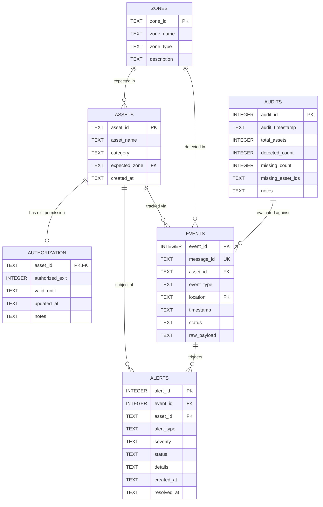

# Database Data Model Specification

**Engine:** SQLite 3  
**Database Name:** `asset_tracking.db`  
**Configuration Reference:** `backend/config.py`  

---

## 1. Entity Relationship Overview

---

## 2. Table Schemas & Constraints

### 2.1. `assets`
Stores registered physical assets monitored by the facility.

| Column | Type | Constraints | Description |
|---|---|---|---|
| `asset_id` | TEXT | PRIMARY KEY | Unique asset code (e.g., `A001`, `A002`) |
| `asset_name` | TEXT | NOT NULL | Friendly asset description (e.g., `Laptop`, `Projector`) |
| `category` | TEXT | DEFAULT 'General' | Equipment category (IT, AV, Warehouse) |
| `expected_zone`| TEXT | NOT NULL | Default designated storage zone (e.g., `SHELF_01`) |
| `created_at` | TEXT | NOT NULL | ISO 8601 UTC creation timestamp |

### 2.2. `zones`
Stores predefined storage, checkpoint, and exit zones.

| Column | Type | Constraints | Description |
|---|---|---|---|
| `zone_id` | TEXT | PRIMARY KEY | Identifier (e.g., `SHELF_01`, `SHELF_02`, `SHELF_03`, `MAIN_GATE`) |
| `zone_name` | TEXT | NOT NULL | Human-readable name (e.g., `Shelf 1 - Storage Bay A`) |
| `zone_type` | TEXT | NOT NULL | `STORAGE`, `GATE`, or `TRANSIT` |
| `description` | TEXT | NULL | Zone location details |

### 2.3. `authorization`
Maintains editable gate exit permissions for physical assets.

| Column | Type | Constraints | Description |
|---|---|---|---|
| `asset_id` | TEXT | PRIMARY KEY, REFERENCES assets(asset_id) | Target asset identifier |
| `authorized_exit` | INTEGER | NOT NULL, CHECK(authorized_exit IN (0, 1)) | 1 = Authorized, 0 = Unauthorized |
| `valid_until` | TEXT | NULL | Expiration timestamp for temporary permits |
| `updated_at` | TEXT | NOT NULL | ISO 8601 timestamp of last permission change |
| `notes` | TEXT | NULL | Justification for exit permit (e.g. `Client demo loan`) |

### 2.4. `events`
Maintains immutable chronological event log for every detection scan.

| Column | Type | Constraints | Description |
|---|---|---|---|
| `event_id` | INTEGER | PRIMARY KEY AUTOINCREMENT | Monotonic event sequence number |
| `message_id` | TEXT | UNIQUE | Unique UUID from IoT/Simulator to prevent duplicate processing |
| `asset_id` | TEXT | NULL | Detected asset ID (can be uncataloged/unknown) |
| `event_type` | TEXT | NOT NULL | `INTERNAL_SCAN`, `GATE_SCAN`, `AUDIT_SCAN`, `MANUAL_SCAN` |
| `location` | TEXT | NOT NULL | Zone where scan was registered |
| `timestamp` | TEXT | NOT NULL | ISO 8601 UTC timestamp of detection |
| `status` | TEXT | NOT NULL | Classified status (e.g., `NORMAL`, `MISPLACED`, `UNAUTHORIZED_EXIT`) |
| `raw_payload` | TEXT | NULL | Sanitized JSON representation for debugging |

### 2.5. `alerts`
Persistent security warnings and operational anomalies requiring staff attention.

| Column | Type | Constraints | Description |
|---|---|---|---|
| `alert_id` | INTEGER | PRIMARY KEY AUTOINCREMENT | Unique alert number |
| `event_id` | INTEGER | NULL, REFERENCES events(event_id) | Related triggering event (if applicable) |
| `asset_id` | TEXT | NULL | Related asset ID |
| `alert_type` | TEXT | NOT NULL | `MISPLACED`, `UNAUTHORIZED_EXIT`, `UNAUTHORIZED_REMOVAL`, `UNKNOWN_ASSET`, `MISSING_INVESTIGATION` |
| `severity` | TEXT | NOT NULL | `LOW`, `MEDIUM`, `HIGH`, `CRITICAL` |
| `status` | TEXT | NOT NULL, DEFAULT 'OPEN' | `OPEN`, `ACKNOWLEDGED`, `RESOLVED` |
| `details` | TEXT | NOT NULL | Human-readable explanation of the anomaly |
| `created_at` | TEXT | NOT NULL | ISO 8601 creation timestamp |
| `resolved_at`| TEXT | NULL | ISO 8601 resolution timestamp |

### 2.6. `audits`
Records scheduled inventory audits and tracks missing asset investigations.

| Column | Type | Constraints | Description |
|---|---|---|---|
| `audit_id` | INTEGER | PRIMARY KEY AUTOINCREMENT | Unique audit identifier |
| `audit_timestamp` | TEXT | NOT NULL | ISO 8601 timestamp when audit was executed |
| `total_assets` | INTEGER | NOT NULL | Total registered assets at audit time |
| `detected_count` | INTEGER | NOT NULL | Number of assets located during audit window |
| `missing_count` | INTEGER | NOT NULL | Number of assets not found |
| `missing_asset_ids` | TEXT | NOT NULL | JSON array of missing asset IDs (e.g. `["A003", "A005"]`) |
| `notes` | TEXT | NULL | Operator or system audit remarks |
