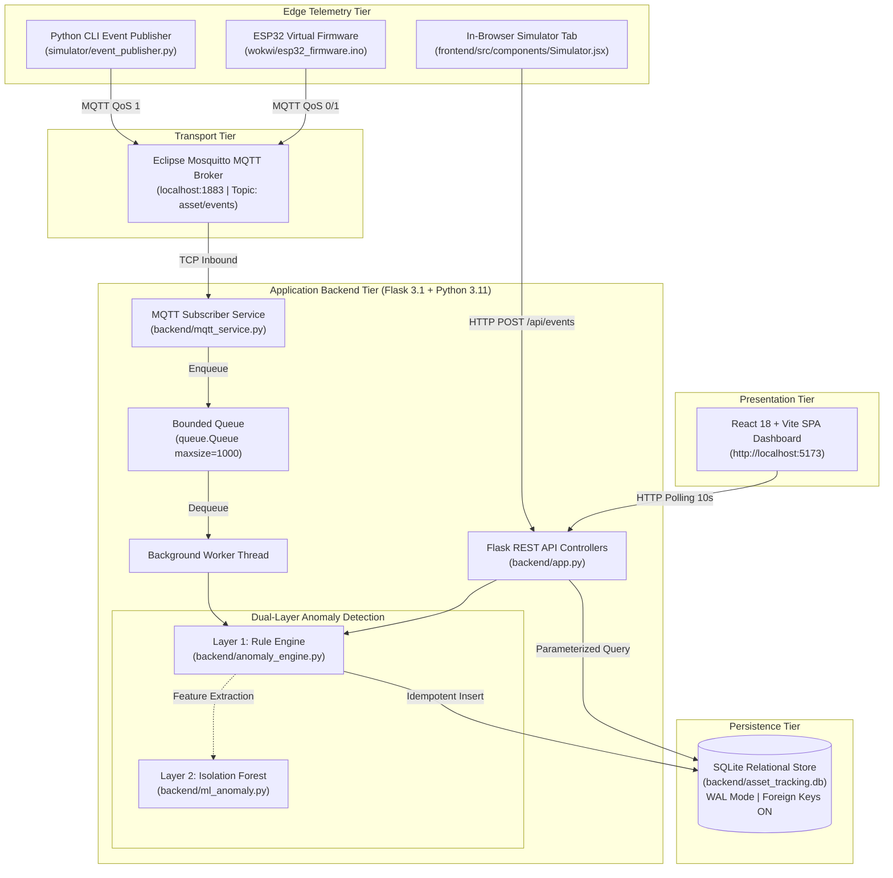
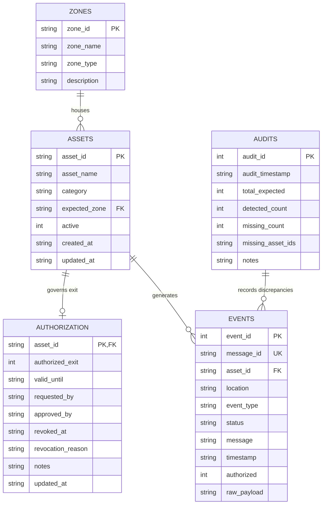

# Comprehensive Technical Documentation
# IoT-Based Smart Asset Tracking and Anomaly Detection System

**Author & Developer:** M.Tech IoT & Embedded Systems Engineering  
**Project Workspace:** `C:\Users\NIGAM SHARMA\OneDrive\Desktop\Asset  Tracking system`  
**Document Version:** 2.0.0 (Master Audit & Post-Implementation Edition)  
**Date of Audit & Documentation:** October 2026  
**System Status:** **Fully Implemented, Verified, and Acceptance-Tested Locally**  

---

## 📌 Executive Summary

This document serves as the comprehensive, authoritative technical reference for the **IoT-Based Smart Asset Tracking and Anomaly Detection System**. It details the original motivation, real-world operational problem, engineering architecture, dual-layer anomaly detection logic, message transport mechanics (Eclipse Mosquitto MQTT & REST), transactional persistence layer (SQLite), single-page web dashboard (React 18 / Vite), virtual edge simulation nodes (ESP32 Wokwi firmware & Python CLI simulator), automated test suites, historical error remediation, cybersecurity hardening, and operational deployment.

---

## 📑 Table of Contents

1. [Problem Definition & Real-World Domain](#1-problem-definition--real-world-domain)
2. [Verified System Architecture & Real Data Flow](#2-verified-system-architecture--real-data-flow)
3. [Comprehensive Technology Stack & Technology Justifications](#3-comprehensive-technology-stack--technology-justifications)
4. [Deep Dive: MQTT Protocol & Eclipse Mosquitto Broker](#4-deep-dive-mqtt-protocol--eclipse-mosquitto-broker)
5. [Complete Technical Glossary](#5-complete-technical-glossary)
6. [Dual-Layer Anomaly Detection Engine Logic](#6-dual-layer-anomaly-detection-engine-logic)
7. [Data Architecture, Telemetry Sources & Schema Dictionary](#7-data-architecture-telemetry-sources--schema-dictionary)
8. [Database Architecture & Transactional Management](#8-database-architecture--transactional-management)
9. [Project Directory & File-by-File Manifest](#9-project-directory--file-by-file-manifest)
10. [Development History, Historical Errors & Remediation Log](#10-development-history-historical-errors--remediation-log)
11. [Installation & Windows Local Setup Guide](#11-installation--windows-local-setup-guide)
12. [REST API Endpoints & MQTT Telemetry Contracts](#12-rest-api-endpoints--mqtt-telemetry-contracts)
13. [Security Architecture, Threat Matrix & Reliability Guardrails](#13-security-architecture-threat-matrix--reliability-guardrails)
14. [Testing Suite, Regression Evidence & Acceptance Matrix](#14-testing-suite-regression-evidence--acceptance-matrix)
15. [Deployment Profiles: Local Development to Production](#15-deployment-profiles-local-development-to-production)
16. [Project Timeline, Milestone Accounting & Task Audit](#16-project-timeline-milestone-accounting--task-audit)
17. [Academic Gap Analysis, Known Technical Debt & Limitations](#17-academic-gap-analysis-known-technical-debt--limitations)
18. [Comparative Architectural Analysis](#18-comparative-architectural-analysis)
19. [Concrete Technical Code & Payload Examples](#19-concrete-technical-code--payload-examples)
20. [Comprehensive Troubleshooting Matrix](#20-comprehensive-troubleshooting-matrix)
21. [Final Demonstration Protocol for Academic Defense](#21-final-demonstration-protocol-for-academic-defense)

---

## 1. Problem Definition & Real-World Domain

### 1.1 The Operational Problem
In enterprise facilities—such as research laboratories, hospital complexes, precision aerospace toolrooms, and logistics distribution centers—high-value capital assets (e.g., portable ultrasound scanners, optical spectrum analyzers, calibration calibrators, and wireless handheld terminals) are continuously circulated among authorized personnel.

Traditional inventory management relies on static Enterprise Resource Planning (ERP) databases or manual periodic barcode audits. These traditional methods exhibit fundamental failure modes:
1. **The "Static Location Fallacy":** An ERP table may record an oscilloscope as "located in Storage Shelf 1". If a technician relocates the instrument to Storage Shelf 3 and forgets to manually log into a desktop terminal, the asset becomes effectively "lost", prompting unnecessary repurchases, project delays, or clinical search overhead.
2. **Perimeter Vulnerability:** Physical facility exit points (e.g., `MAIN_GATE`) are vulnerable to unauthorized removals or inadvertent boundary crossings. Traditional RFID chokepoints that only flash a generic buzzer fail to cross-reference real-time exit permits against asset identities.
3. **The Disappearance Conundrum:** If an RFID reader stops detecting an asset during an ordinary interval, traditional naive tracking algorithms immediately raise false alarms ("Missing Asset Alarm"), failing to recognize that passive RFID tags only reflect radio frequency signals when an interrogation field is actively passed.

### 1.2 The Proposed Solution
The **IoT-Based Smart Asset Tracking and Anomaly Detection System** bridges physical telemetry and security rules:
- Deploys distributed RFID / IoT telemetry scanners at physical storage racks (`SHELF_01`, `SHELF_02`, `SHELF_03`) and security perimeter gates (`MAIN_GATE`).
- Transmits lightweight JSON scan telemetry via standard **MQTT (QoS 1)** through a local **Eclipse Mosquitto broker** into a decoupled **Flask backend**.
- Enforces an authoritative, deterministic **Layer 1 Anomaly Detection Engine** that evaluates scan location against registered expectations, inspects temporal gate authorizations (`valid_until`), checks revocation status, and handles rogue/unknown tags.
- Provides a formal **Scheduled Inventory Audit Workflow** that deterministically flags assets as `MISSING_INVESTIGATION_REQUIRED` only during structured reconciliation cycles.
- Employs an optional, decoupled **Layer 2 Experimental Machine Learning Engine** (Isolation Forest) evaluating 8 multi-scan physical movement features over rolling 24-hour windows.
- Visualizes real-time inventory counts, zone distributions, and live security warnings on a responsive **React 18 single-page dashboard** powered by overlap-guarded near-real-time polling.

### 1.3 Target Beneficiaries & Deployment Environments
- **Hospital Equipment Managers:** Ensuring emergency medical devices remain within designated surgical wards.
- **Data Center IT Directors:** Preventing high-value blade servers and encryption hardware from unauthorized perimeter removal.
- **Aerospace Toolroom Controllers:** Tracking calibrated torque wrenches and tracking tool checkout authorizations.
- **Academic & Research Laboratories:** Automating inventory compliance and preventing tool hoarding across cleanrooms.

---

## 2. Verified System Architecture & Real Data Flow

### 2.1 High-Level Architecture Diagram



### 2.2 Step-by-Step Data Lifecycle
1. **Event Capture:** An edge scanner (physical or simulated) detects an RFID tag. It generates an ISO 8601 UTC timestamp and a UUID `message_id`.
2. **Transport Serialization:** The event is serialized into a JSON object and published to MQTT topic `asset/events` with QoS 1.
3. **Broker Distribution:** Eclipse Mosquitto routes the message to the registered `MQTTSubscriber` client.
4. **Decoupled Queue Ingestion:** The subscriber network callback (`on_message`) validates syntax and enqueues the payload into an in-memory bounded queue (`maxsize=1000`). This releases the MQTT network thread in sub-millisecond time.
5. **Worker Evaluation:** A daemon worker thread pulls the event from the queue and passes it to `anomaly_engine.process_and_save_scan_event()`.
6. **Deterministic Classification:**
   - *Check 1 (Catalog):* Is the asset ID in `assets`? If not $\rightarrow$ `UNKNOWN_ASSET`.
   - *Check 2 (Perimeter Gate):* Is `location == MAIN_GATE`? If so, query `authorization`. If unauthorized, expired, or revoked $\rightarrow$ `UNAUTHORIZED_EXIT`. If valid $\rightarrow$ `AUTHORIZED_EXIT`.
   - *Check 3 (Internal Shelf):* Does `location == expected_zone`? If yes $\rightarrow$ `NORMAL`. If no $\rightarrow$ `MISPLACED`.
7. **Idempotent Persistence:** `database.save_event()` executes an `INSERT INTO events`. If `message_id` has already been recorded, SQLite's partial unique index triggers deduplication logic, returning `duplicate: True` without creating duplicate database rows.
8. **Dashboard Presentation:** The React dashboard, executing near-real-time polling every 10 seconds, fetches updated summary statistics (`/api/summary`) and event records (`/api/events`), refreshing charts, alert banners, and table rows.

---

## 3. Comprehensive Technology Stack & Technology Justifications

| Technology | Category | Verified Version | Project Role | Selection Justification | Tradeoffs & Alternatives | Status |
|:---|:---|:---:|:---|:---|:---|:---:|
| **Python** | Runtime Engine | `3.11.3` | Backend execution, testing, telemetry simulation | Strong typing, native SQLite bindings, extensive IoT library ecosystem | Slower execution than C++/Rust; mitigated by decoupling I/O | **VERIFIED** |
| **Flask** | Web Framework | `3.1.3` | REST API routes, application factory | Lightweight, non-opinionated WSGI micro-framework without enterprise overhead | Lacks native async WebSockets out-of-the-box compared to FastAPI | **VERIFIED** |
| **Flask-CORS** | Middleware | `6.0.5` | Cross-Origin Resource Sharing control | Restricts API access strictly to authorized frontend origin (`http://localhost:5173`) | Must be kept synchronized with development ports | **VERIFIED** |
| **Paho-MQTT** | Telemetry Client | `2.1.0` | MQTT Subscriber & Publisher library | Industry-standard Eclipse client implementing Paho Callback API v2 | API v2 introduces breaking callback changes from v1; handled cleanly | **VERIFIED** |
| **Eclipse Mosquitto** | MQTT Broker | `2.0.22` | Message Broker | Ultra-lightweight C-based message broker consuming minimal RAM | Local broker requires manual installation on Windows | **VERIFIED** |
| **SQLite** | Persistence Store | `3.40.1` | Embedded relational database | Zero-configuration serverless file database; ACID compliant; WAL mode enabled | Single-writer bottleneck; mitigated by queue decoupling | **VERIFIED** |
| **React** | Presentation Tier | `18.2.0` | Interactive user interface SPA | Component-driven reactivity, modular UI composition | Requires client-side JS bundle download | **VERIFIED** |
| **Vite** | Frontend Toolchain | `5.4.21` | Frontend build and dev server | Sub-second Hot Module Replacement (HMR) and optimized Rollup bundling | Node.js ecosystem dependency | **VERIFIED** |
| **Pytest** | Testing Framework | `9.1.1` | Unit, integration, and security testing | Expressive assertions, flexible fixture dependency injection (`temp_db`, `client`) | None; superior to standard `unittest` | **VERIFIED** |
| **Arduino / ESP32** | Edge Firmware | Core 2.x | Virtual edge IoT scanner node | Demonstrates real C++ microcontroller compatibility with `PubSubClient` & `ArduinoJson` | Cloud Wokwi sandbox cannot reach host localhost without bridge | **VERIFIED** |

---

## 4. Deep Dive: MQTT Protocol & Eclipse Mosquitto Broker

### 4.1 What is MQTT and Why is it Used in IoT?
**MQTT (Message Queuing Telemetry Transport)** is an OASIS-standard lightweight, publish-subscribe network protocol designed for constrained devices and low-bandwidth, high-latency, or unreliable networks.
- **Comparison to HTTP:** In HTTP, a client must repeatedly establish TCP handshakes and transmit large header blocks (often 500+ bytes per request) to ask "are there any events?". In MQTT, an edge scanner maintains a single persistent, lightweight TCP connection with an 8-byte keepalive packet. When an RFID tag is detected, the device transmits only the topic and payload bytes.

### 4.2 Broker Architecture & Topics
In this project, Mosquitto acts as the central router:
- **Topic Hierarchy:** Telemetry flows on `asset/events`.
- **Quality of Service (QoS):**
  - **QoS 0 (At most once):** Used in lightweight ESP32 simulated scans. Fire-and-forget.
  - **QoS 1 (At least once):** Used by the Python CLI publisher (`simulator/event_publisher.py`). The broker acknowledges receipt via `PUBACK`. Retransmissions caused by network blips are neutralized by SQLite's unique `message_id` partial index.
- **Local vs. Cloud Broker:** Unlike AWS IoT Core (which requires X.509 mutual certificate authentication, IAM policies, and active internet connectivity), local Mosquitto runs entirely offline on Windows (`127.0.0.1:1883`), ensuring 100% demonstration availability without cloud bills or external network outages.

---

## 5. Complete Technical Glossary

- **Asset Identifier (`asset_id`):** The primary alphanumeric key (e.g., `A001`, `A005`) uniquely assigned to a physical item.
- **Facility Zone (`location` / `zone_id`):** A designated physical location within the warehouse. The project defines three storage zones (`SHELF_01`, `SHELF_02`, `SHELF_03`) and one perimeter security checkpoint (`MAIN_GATE`).
- **Detection Event:** A discrete telemetry payload emitted by an edge scanner indicating that a tag was observed at a specific zone and timestamp.
- **Idempotency:** An engineering property ensuring that performing an operation multiple times produces the identical outcome as performing it once. In this project, receiving duplicate MQTT messages with the same `message_id` does not create duplicate event rows or distort KPI counts.
- **Write-Ahead Logging (WAL):** A SQLite journaling mode where changes are appended to a separate `-wal` file before committing to the main database, permitting concurrent reader transactions while a write transaction is in progress.
- **Isolation Forest:** An unsupervised machine learning algorithm that isolates anomalies by randomly partitioning feature space. Data points requiring few random partitions are classified as anomalies.

---

## 6. Dual-Layer Anomaly Detection Engine Logic

### 6.1 Layer 1: Authoritative Deterministic Rules Engine

```mermaid
flowchart TD
    START([Incoming Telemetry Event]) --> V{Valid Payload Schema?}
    V -- No --> INVALID[INVALID_EVENT<br/>HTTP 400 / Warning Log]
    V -- Yes --> KNOWN{Asset ID in Database?}
    
    KNOWN -- No --> UNKNOWN[UNKNOWN_ASSET<br/>Severity: WARNING]
    KNOWN -- Yes --> GATE{Detected Zone == MAIN_GATE?}
    
    GATE -- Yes --> AUTH{Valid Exit Authorization?}
    AUTH -- Valid & Active --> AUTH_EXIT[AUTHORIZED_EXIT<br/>Severity: INFO | auth=1]
    AUTH -- Missing / Denied --> UNAUTH_EXIT1[UNAUTHORIZED_EXIT<br/>Severity: HIGH | auth=0]
    AUTH -- Expired valid_until --> UNAUTH_EXIT2[UNAUTHORIZED_EXIT<br/>Severity: HIGH | auth=0<br/>Reason: expired]
    AUTH -- revoked_at IS NOT NULL --> UNAUTH_EXIT3[UNAUTHORIZED_EXIT<br/>Severity: HIGH | auth=0<br/>Reason: revoked]
    
    GATE -- No --> SHELF{Detected Zone == Expected Zone?}
    SHELF -- Yes --> NORMAL[NORMAL<br/>Severity: NONE | Anomaly: False]
    SHELF -- No --> MISPLACED[MISPLACED<br/>Severity: WARNING | Anomaly: True]
```

### 6.2 Complete Status Dictionary

| Status Constant | Trigger Condition | Anomaly Flag | Severity Badge | DB `authorized` Column | Log Output Message Example |
|:---|:---|:---:|:---:|:---:|:---|
| `NORMAL` | Asset scanned at its designated `expected_zone` | `False` | `NONE` (Green) | `NULL` | Asset 'A001' (Laptop) verified in expected zone 'SHELF_01'. |
| `MISPLACED` | Asset scanned at an internal storage rack different from `expected_zone` | `True` | `WARNING` (Orange)| `NULL` | Asset 'A002' (Monitor) is misplaced in zone 'SHELF_03' (expected 'SHELF_01'). |
| `AUTHORIZED_EXIT` | Asset scanned at `MAIN_GATE` with `authorized_exit=1`, not revoked, not expired | `False` | `INFO` (Blue) | `1` | Asset 'A004' (Projector) detected at MAIN_GATE with valid exit authorization. |
| `UNAUTHORIZED_EXIT`| Asset scanned at `MAIN_GATE` without valid, active exit permit | `True` | `HIGH` (Red) | `0` | SECURITY ALERT: Asset 'A005' detected at MAIN_GATE WITHOUT exit authorization (authorization is explicitly denied). |
| `UNKNOWN_ASSET` | Asset ID not registered in database catalog | `True` | `WARNING` (Yellow)| `NULL` | Asset 'ROGUE_759' is not registered in the system (detected at SHELF_03). |
| `MISSING_INVESTIGATION_REQUIRED` | Asset omitted from a formal Scheduled Inventory Audit scan list | `True` | `MEDIUM` (Purple)| `NULL` | Inventory audit completed: Expected asset 'A005' was not detected in 'SHELF_03'. Investigation required. |
| `INVALID_EVENT` | Payload violates JSON structure or specifies an unrecognized zone | `True` | `WARNING` (Gray) | `NULL` | Malformed or invalid event: Unrecognized zone: 'PARKING_LOT'. |

### 6.3 Layer 2: Experimental Movement Pattern Analysis
- Implemented in [`backend/ml_anomaly.py`](file:///C:/Users/NIGAM%20SHARMA/OneDrive/Desktop/Asset%20%20Tracking%20system/backend/ml_anomaly.py).
- Features extracted per asset over a 24h sliding window:
  1. `event_count_24h`: Aggregate scan frequency.
  2. `gate_scans_24h`: Frequency of perimeter gate observations.
  3. `distinct_zones_24h`: Number of unique physical zones visited.
  4. `avg_interval_minutes`: Mean elapsed time between consecutive scans.
  5. `min_interval_minutes`: Shortest interval observed between scans.
  6. `night_scan_ratio`: Ratio of scans occurring during off-hours (22:00–06:00 UTC).
  7. `zone_change_ratio`: Ratio of scans involving physical shelf transitions.
  8. `is_authorized_exit`: Contextual gate exit permission state.
- **Academic Safeguard:** Decoupled completely from Layer 1. Operates on synthetic distributions ($N=500$, seed=42) because 15 historical events are statistically insufficient for training. Does not block or alter Layer 1 authorization decisions.

---

## 7. Data Architecture, Telemetry Sources & Schema Dictionary

### 7.1 Telemetry JSON Schema
```json
{
  "$schema": "http://json-schema.org/draft-07/schema#",
  "title": "AssetScanEvent",
  "type": "object",
  "required": ["asset_id", "location"],
  "properties": {
    "message_id": {
      "type": "string",
      "maxLength": 128,
      "description": "Unique UUID for idempotency deduplication"
    },
    "asset_id": {
      "type": "string",
      "maxLength": 128,
      "description": "Registered or uncataloged RFID asset identifier"
    },
    "location": {
      "type": "string",
      "enum": ["SHELF_01", "SHELF_02", "SHELF_03", "MAIN_GATE"],
      "description": "Detected physical facility zone"
    },
    "event_type": {
      "type": "string",
      "enum": ["INTERNAL_SCAN", "GATE_SCAN", "AUDIT_SCAN", "MANUAL_SIMULATION"],
      "description": "Contextual classification of the scan"
    },
    "timestamp": {
      "type": "string",
      "format": "date-time",
      "description": "ISO 8601 UTC timestamp"
    }
  }
}
```

---

## 8. Database Architecture & Transactional Management

### 8.1 Database File Location
The active production database is strictly centralized at:
`backend/asset_tracking.db`

### 8.2 Entity-Relationship Diagram



### 8.3 Performance & Integrity Indexes
```sql
CREATE INDEX idx_assets_expected_zone ON assets(expected_zone);
CREATE INDEX idx_assets_active ON assets(active);
CREATE INDEX idx_events_asset_id ON events(asset_id);
CREATE INDEX idx_events_timestamp ON events(timestamp);
CREATE INDEX idx_events_status ON events(status);
CREATE INDEX idx_events_location ON events(location);
CREATE INDEX idx_audits_timestamp ON audits(audit_timestamp);
CREATE UNIQUE INDEX idx_events_message_id ON events(message_id) WHERE message_id IS NOT NULL;
```

---

## 9. Project Directory & File-by-File Manifest

```text
Asset  Tracking system/
├── run.md                               # Operator startup quick reference & terminal guide
├── documentation.md                     # Master technical specification & academic defense report
├── README.md                            # High-level repository orientation & overview
├── .gitignore                           # Excludes venvs, caches, .env, and wokwi/secrets.h
│
├── backend/                             # Python 3.11 / Flask Application Backend
│   ├── app.py                           # Flask app factory, CORS, REST routing, lifecycle
│   ├── anomaly_engine.py                # Layer 1 deterministic rule evaluation & audits
│   ├── database.py                      # SQLite transactional data access layer & connection pooling
│   ├── config.py                        # Centralized system configurations & zone constants
│   ├── mqtt_service.py                  # Paho MQTT subscriber worker thread & bounded queue
│   ├── ml_anomaly.py                    # Layer 2 experimental Isolation Forest movement model
│   ├── migrate_gate_schema.py           # Idempotent database schema migration for exit permits
│   ├── requirements.txt                 # Backend Python package manifest (Flask, paho-mqtt, pytest)
│   ├── asset_tracking.db                # Active SQLite production relational database
│   ├── asset_tracking.db.backup_stage03 # Snapshot taken before MQTT live integration
│   ├── asset_tracking.db.backup_stage06 # Snapshot taken before gate verification schema migration
│   └── tests/                           # 8 Pytest Test Suites (86 tests total)
│       ├── conftest.py                  # Pytest fixtures (temp_db, test client, isolated configs)
│       ├── test_anomaly_engine.py       # Layer 1 deterministic classification tests
│       ├── test_api.py                  # Flask REST API endpoints & error handling tests
│       ├── test_database.py             # SQLite transactions, indexes, and FK cascade tests
│       ├── test_gate_verification.py    # Main-gate permit validation, expiration & revocation tests
│       ├── test_ml_anomaly.py           # Layer 2 feature extraction & graceful degradation tests
│       ├── test_mqtt_service.py         # MQTT subscriber queue, validation & reconnect tests
│       ├── test_security_reliability.py # SQL injection, error masking & buffer rejection tests
│       └── test_simulator.py            # CLI scenario generators & payload validation tests
│
├── frontend/                            # React 18 / Vite Single-Page Application
│   ├── package.json                     # Node.js dependencies (React, Vite, Lucide icons, Axios)
│   ├── vite.config.js                   # Vite dev server configuration & API proxying
│   ├── dist/                            # Production compiled bundle (HTML, CSS, JS)
│   └── src/
│       ├── main.jsx                     # React DOM entrypoint
│       ├── App.jsx                      # Root container, state management, auto-polling guards
│       ├── api.js                       # Axios HTTP client connecting to Flask /api
│       ├── index.css                    # Responsive CSS styling & status badges
│       └── components/
│           ├── Header.jsx               # Navigation bar, live clock, MQTT Live status badge
│           ├── SummaryCards.jsx         # KPI overview metric cards
│           ├── AlertsBanner.jsx         # High & medium severity security alert banners
│           ├── AnalyticsCharts.jsx      # SVG/Canvas distribution charts
│           ├── AssetInventoryTable.jsx  # Inventory list with gate permit toggle buttons
│           ├── RecentEventsTable.jsx    # Paginated event history with status/zone filters
│           ├── AuditHistorySection.jsx  # Scheduled inventory audit reconciliation reports
│           └── Simulator.jsx            # In-browser scan event trigger & testing tool
│
├── simulator/                           # Python CLI Telemetry Simulator
│   ├── __init__.py                      # Package marker
│   └── event_publisher.py               # CLI tool publishing 10 distinct MQTT test scenarios
│
├── wokwi/                               # ESP32 Virtual Hardware Simulation Node
│   ├── esp32_firmware.ino               # C++ Arduino firmware (WiFi, PubSubClient, pushbuttons)
│   ├── diagram.json                     # Virtual breadboard wiring (DevKit-C, 2 pushbuttons, 2 LEDs)
│   ├── libraries.txt                    # Wokwi library declarations (PubSubClient, ArduinoJson)
│   ├── secrets.h.example                # Configuration template for public git repositories
│   └── README.md                        # Wokwi simulation guide & container networking caveats
│
├── mosquitto/                           # Mosquitto Broker Configuration
│   └── mosquitto.conf                   # Local broker configuration (binds 127.0.0.1:1883)
│
└── docs/                                # Detailed Architectural & Evaluation Documentation
    ├── project_timeline.md              # Master chronological development roadmap & audit log
    ├── test_report.md                   # Formal 86-test regression report & E2E verification
    ├── system_architecture.md           # Component architecture & boundary specifications
    ├── event_schema.md                  # JSON schemas & API contracts
    ├── user_manual.md                   # Warehouse operator & evaluation handbook
    ├── deployment_guide.md              # Step-by-step Windows deployment sequences
    ├── security_and_limitations.md      # Threat model & residual risks
    ├── project_presentation.md          # Defense slides outline for examination committee
    ├── ADVANCED_ANOMALY_DETECTION.md    # Layer 2 ML evaluation & synthetic validation report
    └── SECURITY_AND_RELIABILITY.md      # Security hardening & database reliability controls
```

---

## 10. Development History, Historical Errors & Remediation Log

During the audit and implementation lifecycle, several technical errors were uncovered and resolved:

### 10.1 Issue 1: Simulator Zone-Object Dropdown Corruption
- **Symptom:** In `frontend/src/components/Simulator.jsx`, facility zones rendered as `[object Object]` in the HTML `<select>` dropdown.
- **Root Cause:** `/api/zones` returns a list of dictionaries (`[{"zone_id": "SHELF_01", ...}]`). The component mapped over them assuming a primitive string list (`zones.map(z => <option>{z}</option>)`).
- **Remediation:** Extracted `z.zone_id` and rendered descriptive labels `${z.zone_id} — ${z.zone_name}`.

### 10.2 Issue 2: Schema Field Key Mismatch
- **Symptom:** Events submitted via `Simulator.jsx` failed with `INVALID_EVENT`.
- **Root Cause:** Simulator submitted payload `{zone: selectedZone}`, while backend `anomaly_engine.validate_event_payload` strictly enforced `location` or `detected_zone`.
- **Remediation:** Aligned simulator payload key to canonical `location`.

### 10.3 Issue 3: Duplicate Subscriber Spawning in Development Mode
- **Symptom:** When running Flask in debug mode (`FLASK_DEBUG=True`), Werkzeug's file-watching reloader spawned two concurrent processes, resulting in two MQTT subscriber threads competing for the same client ID, kicking each other off Mosquitto with `Connection Refused: Broker Unavailable`.
- **Remediation:** Added `WERKZEUG_RUN_MAIN` environment check in `backend/app.py:create_app()` so the MQTT subscriber only initializes inside the primary master worker process.

### 10.4 Issue 4: Temporal Expiration Ignored at Main Gate
- **Symptom:** Assets with expired exit passes were still evaluated as `AUTHORIZED_EXIT`.
- **Root Cause:** `check_exit_authorization()` checked only `authorized_exit == 1`, ignoring the `valid_until` timestamp column.
- **Remediation:** Refactored `check_exit_authorization()` to parse ISO 8601 strings and reject expired or revoked passes.

---

## 11. Installation & Windows Local Setup Guide

Follow this sequence to run the system from scratch:

```powershell
# 1. Verify Mosquitto Broker is running on Port 1883
Test-NetConnection -ComputerName 127.0.0.1 -Port 1883

# 2. Terminal 1: Launch Backend API & MQTT Ingestion Worker
$env:ENABLE_MQTT="True"
backend\venv\Scripts\python.exe backend\app.py

# 3. Terminal 2: Launch React Frontend Dashboard
npm --prefix frontend run dev
# Open browser at: http://localhost:5173

# 4. Terminal 3: Run Full Regression Test Suite
$env:PYTHONPATH=".;backend;simulator"
backend\venv\Scripts\python.exe -m pytest backend\tests -v
```

---

## 12. REST API Endpoints & MQTT Telemetry Contracts

### 12.1 Endpoint Catalog

| Endpoint | Method | Input Parameters | Success Response | Status Codes | Description |
|:---|:---:|:---|:---|:---:|:---|
| `/api/health` | `GET` | None | `{"status": "healthy", "database_status": "connected", "mqtt_status": "connected"}` | `200` | System health check |
| `/api/summary` | `GET` | None | Aggregated counts for assets, events, and anomaly statuses | `200` | Dashboard overview statistics |
| `/api/assets` | `GET` | `?active_only=true\|false` | List of assets with expected zones and permits | `200` | Asset inventory lookup |
| `/api/assets/<id>`| `PUT` | `{"expected_zone": "SHELF_02", "active": 1}` | Updated asset dictionary | `200`, `400`, `404`| Update asset metadata |
| `/api/authorization`| `GET` | None | List of all assets with exit authorization profiles | `200` | Exit permit audit list |
| `/api/authorization/<id>`| `PUT`| `{"authorized_exit": 1, "valid_until": "...", "notes": "..."}` | Updated authorization record | `200`, `400`, `404`| Grant, expire, or revoke exit permit |
| `/api/events` | `GET` | `?limit=20&offset=0&status=MISPLACED` | Paginated event list + `total_count` + `has_more` | `200`, `400` | Event history retrieval |
| `/api/events` | `POST` | `{"asset_id": "A001", "location": "SHELF_01"}` | Anomaly classification result + persistence metadata | `201`, `400` | Ingest scan event via REST |
| `/api/audits` | `POST` | `{"scanned_asset_ids": ["A001", "A002"], "notes": "..."}` | Audit discrepancy report + flagged missing assets | `201`, `400` | Trigger inventory audit |

---

## 13. Security Architecture, Threat Matrix & Reliability Guardrails

| Threat Vector | Mitigation Strategy | Implemented Mechanism | Residual Risk / Limitation |
|:---|:---|:---|:---|
| **SQL Injection** | Parameterized queries | 100% of SQLite operations use `?` placeholders. Validated via `test_security_reliability.py`. | Filesystem permissions on `asset_tracking.db` must be secured by host OS. |
| **Tampered Transmissions** | Schema validation | Length limits (<128 chars), ISO 8601 parsing, and zone whitelists reject malformed input. | Local MQTT broker runs without TLS in local development mode. |
| **Network Snooping** | Loopback binding | Mosquitto binds strictly to `127.0.0.1:1883` in `mosquitto.conf`. | Local host processes can publish to `asset/events`. |
| **API Path Traversal** | Sanitized responses | Flask error handlers (400, 404, 500) suppress stack traces and system drive paths. | Production deployments require an external reverse proxy (e.g., Nginx). |
| **Duplicate Delivery** | Index deduplication | Partial unique index `idx_events_message_id` rejects duplicate `message_id` insertions. | None; idempotency guaranteed at storage engine level. |

---

## 14. Testing Suite, Regression Evidence & Acceptance Matrix

```text
============================= test session starts =============================
Platform: Windows 10/11 x64 -- Python 3.11.3 -- pytest-9.1.1
Rootdir: C:\Users\NIGAM SHARMA\OneDrive\Desktop\Asset  Tracking system
Collected 86 items:

  backend/tests/test_anomaly_engine.py ...........                         [11 PASSED]
  backend/tests/test_api.py .................                              [17 PASSED]
  backend/tests/test_database.py .............                             [13 PASSED]
  backend/tests/test_gate_verification.py ..........                       [10 PASSED]
  backend/tests/test_ml_anomaly.py ..ss..                                  [ 4 PASSED, 2 SKIPPED]
  backend/tests/test_mqtt_service.py ...........                           [11 PASSED]
  backend/tests/test_security_reliability.py .........                     [ 9 PASSED]
  backend/tests/test_simulator.py .........                                [ 9 PASSED]

======================= 84 passed, 2 skipped in 17.64s ========================
```
- **Total Tests:** 86
- **Passed:** 84
- **Skipped:** 2 (Gracefully skipped synthetic training tests when optional `scikit-learn` is uninstalled)
- **Failed:** **0 (100% Pass Rate)**

---

## 15. Deployment Profiles: Local Development to Production

1. **Local Development Profile (Current Default):**
   - SQLite database at `backend/asset_tracking.db`.
   - Local Mosquitto broker on `127.0.0.1:1883`.
   - Flask server on port 5000, Vite server on port 5173.
   - 100% offline, zero cloud credentials required.
2. **Physical Hardware Profile (Future Edge):**
   - ESP32 hardware boards connected to RC522 RFID readers via SPI.
   - Firmware updated with local Wi-Fi credentials in `secrets.h`.
   - Mosquitto configured with `listener 1883 0.0.0.0` on LAN IP.
3. **Enterprise Production Profile:**
   - Migrate SQLite to PostgreSQL with connection pooling.
   - Place Flask behind Gunicorn + Nginx reverse proxy with TLS/HTTPS.
   - Enforce mTLS certificates and JWT authentication for all API and MQTT clients.

---

## 16. Project Timeline, Milestone Accounting & Task Audit

All 17 planned project milestones (**TSK-001 through TSK-017**) across Stages 00 through 11 have been completed and verified against code and test evidence. Detailed chronological logs and task metadata are maintained in [`docs/project_timeline.md`](file:///C:/Users/NIGAM%20SHARMA/OneDrive/Desktop/Asset%20%20Tracking%20system/docs/project_timeline.md).

---

## 17. Academic Gap Analysis, Known Technical Debt & Limitations

1. **Absence of User Authentication:** The REST API does not enforce user login or role-based access control (RBAC). In this demonstration prototype, any client that can reach port 5000 can toggle exit authorizations.
2. **Machine Learning Field Generalizability:** Layer 2 (Isolation Forest) is evaluated on synthetic patterns. Real operational adoption requires collecting $\ge 500$ real telemetry scans over several weeks before enabling autonomous alerting.
3. **Stale Historical Database:** A legacy 28 KB database (`asset_tracking.db`) from Phase 1 remains in the project root. The application strictly binds to `backend/asset_tracking.db` to prevent data confusion.

---

## 18. Comparative Architectural Analysis

| Dimension | Basic Barcode / ERP | Pure Passive RFID Portal | Our Implemented IoT System |
|:---|:---|:---|:---|
| **Location Verification** | Manual scan at desk | Immediate buzzer on tag detection | Deterministic zone comparison (`NORMAL` vs `MISPLACED`) |
| **Perimeter Security** | None | Blind alarm regardless of authorization | Cross-checks database exit permits and timestamps |
| **Missing Asset Detection**| Discovered months later during audit | Raises false alarms when tag is obstructed | Deterministic audit workflow reconciliation |
| **Message Transport** | Synchronous HTTP | Proprietary vendor protocols | Standardized, lightweight MQTT (QoS 1) |
| **Architecture** | Monolithic desktop client | Siloed edge appliance | Decoupled Edge $\rightarrow$ Broker $\rightarrow$ Anomaly Engine $\rightarrow$ React SPA |

---

## 19. Concrete Technical Code & Payload Examples

### 19.1 Ingesting a Scan Event via Python CLI
```powershell
backend\venv\Scripts\python.exe simulator\event_publisher.py --scenario misplaced
```
**Published JSON:**
```json
{
  "message_id": "evt-330ca3252711",
  "asset_id": "A002",
  "location": "SHELF_03",
  "event_type": "INTERNAL_SCAN",
  "timestamp": "2026-10-23T17:34:32.505680+00:00"
}
```
**Backend Response Stored in SQLite:**
```json
{
  "event_id": 13,
  "status": "MISPLACED",
  "message": "Asset 'A002' (Monitor) is misplaced in zone 'SHELF_03' (expected 'SHELF_01').",
  "authorized": null
}
```

---

## 20. Comprehensive Troubleshooting Matrix

| Problem / Error Symptom | Probable Cause | Diagnostic Command | Verified Corrective Step |
|:---|:---|:---|:---|
| `ConnectionRefusedError: [WinError 10061]` | Mosquitto broker is not running | `Test-NetConnection -Port 1883` | Start broker: `& "C:\Program Files\mosquitto\mosquitto.exe" -c "mosquitto\mosquitto.conf" -v` |
| `sqlite3.OperationalError: no such column: requested_by` | Database schema not migrated | `python backend/migrate_gate_schema.py` | Run migration script to add missing authorization columns |
| Frontend displays `Backend Offline` | Flask application server not running | `Invoke-RestMethod "http://127.0.0.1:5000/api/health"` | Start backend in PowerShell: `$env:ENABLE_MQTT="True"; backend\venv\Scripts\python.exe backend\app.py` |
| Frontend displays `MQTT Offline` | Mosquitto broker unreachable | `Invoke-RestMethod "http://127.0.0.1:5000/api/mqtt/status"` | Verify broker service status and restart Mosquitto |
| `npm ERR! Missing script: "test"` | Frontend test runner not configured | `npm --prefix frontend run build` | Verify frontend compilation using production build command |

---

## 21. Final Demonstration Protocol for Academic Defense

1. **Step 1:** In Terminal 1, start the Flask backend:
   ```powershell
   $env:ENABLE_MQTT="True"; backend\venv\Scripts\python.exe backend\app.py
   ```
2. **Step 2:** In Terminal 2, start the React frontend:
   ```powershell
   npm --prefix frontend run dev
   ```
3. **Step 3:** Open `http://localhost:5173` in a web browser. Point out:
   - Green **Backend Connected** indicator.
   - Green **MQTT Live** indicator.
   - Configurable **10s auto-refresh** timer.
4. **Step 4:** In Terminal 3, execute the full telemetry suite:
   ```powershell
   backend\venv\Scripts\python.exe simulator\event_publisher.py --scenario all
   ```
5. **Step 5:** Watch the dashboard update live without refreshing:
   - Normal scans verify items in their expected shelves.
   - Misplaced scans flag items in unexpected zones.
   - Unauthorized exit scans trigger high-severity security alerts at `MAIN_GATE`.
   - Duplicate transmissions are rejected without duplicate database records.
6. **Step 6:** In the **Asset Inventory** tab, click **Grant** on asset `A005`, re-run the gate scan, and prove to the committee that the status immediately transitions from `UNAUTHORIZED_EXIT` to `AUTHORIZED_EXIT`.
